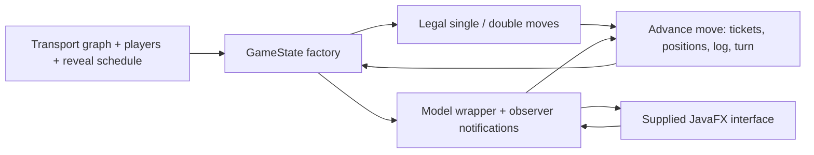

# Scotland Yard — Java Game Model

**Graph-based move generation, game-state transitions and observer-driven interaction.**

A collaborative University of Bristol Java coursework project implementing the model
for Scotland Yard. Mr X and the detectives move across a transport graph with ticket
constraints, hidden/revealed travel information and game-ending conditions.

## Scope and provenance

This repository includes a university-provided API, JavaFX interface, assets and tests.
The coursework implementations are primarily
[MyGameStateFactory.java](src/main/java/uk/ac/bris/cs/scotlandyard/model/MyGameStateFactory.java)
and [MyModelFactory.java](src/main/java/uk/ac/bris/cs/scotlandyard/model/MyModelFactory.java).
It is not an independently built game engine or a deployed commercial application.

**Team:** Aryan Rezaei Amiri and Oscar. Aryan's
[commit history](https://github.com/Faulty-uni/West-Java/commits/main/?author=Aryan-R-A)
records game-state work, comments and iterative debugging against the supplied tests,
including [this implementation revision](https://github.com/Faulty-uni/West-Java/commit/f1c548c0bf560fd55592b8ce8169dcc3f510746e).
The final implementation combines both contributors' work; exact line-by-line ownership
and authorship of supplied tests are not inferred from repository access.

## How it works



- **Legal moves:** traverse adjacent graph nodes and inspect transport/ticket choices.
  Detective occupancy, secret tickets and Mr X's double moves affect eligibility.
- **Transitions:** spend and transfer tickets, update locations, append revealed or
  hidden log entries and determine who may move next.
- **Termination:** evaluate capture, exhausted rounds and movement availability.
- **Observers:** notify registered consumers when the model advances or ends the game.

The interesting engineering problem is keeping these interacting rules consistent.
Graph traversal, state modelling, the move visitor and observer pattern are more
substantive evidence than the appearance of the supplied interface.

## Stack and project layout

Java **17**, Maven, Guava immutable collections and graph APIs, JavaFX **17.0.2**.
The supplied test stack includes JUnit 4, AssertJ, Mockito and EqualsVerifier.

```text
src/main/java/.../model/     model API and coursework implementations
src/main/java/.../ui/        supplied interface and controllers
src/main/resources/         transport graph, map, layouts and other assets
src/test/java/.../model/     supplied model and observer tests
pom.xml                     build, test-suite selection and application entry point
```

## Build and run

Install **JDK 17** and **Maven**, then run from the repository root:

```bash
git clone https://github.com/Faulty-uni/West-Java.git
cd West-Java
mvn test
mvn compile exec:java
```

The desktop interface requires a graphical environment and appropriate JavaFX support.
See [the bundled manual](src/main/resources/manual/MANUAL.md) for game interaction.

## Testing and evidence

The Maven configuration selects the supplied aggregate suite.
The source tests cover creation invariants, legal moves, transitions, winning conditions,
playouts, player/ticket access and observer behaviour.

**Executed on 12 October 2026:** `mvn -B test` passed **83 tests**, with **zero failures,
errors or skips**, in an isolated Maven 3.9.11 / Eclipse Temurin 17 container.
The source baseline was `main@11ea6c9141665717caddcef7094b5a23593dca04`.
These are the supplied suite's checks, not 83 tests authored by the students.

[The proposed CI workflow](.github/workflows/java.yml) runs that Maven suite on Java 17.
Its GitHub result should be checked for the specific PR or commit being reviewed.

## Limitations and next steps

- Review state immutability and side effects across successive game states.
- Review duplicate/null observer handling and the consistency of terminal-state access.
- Extend regression coverage for state immutability and observer edge cases where needed.
- Attribute supplied code, images and tests; the resource licence does not by itself
  establish a licence for every contribution in the repository.
- Confirm applicable coursework publication rules before redistributing solutions.

This project contributes **algorithms and software-design evidence** to a portfolio.
It does not claim machine-learning research, a custom AI player or distributed execution.
